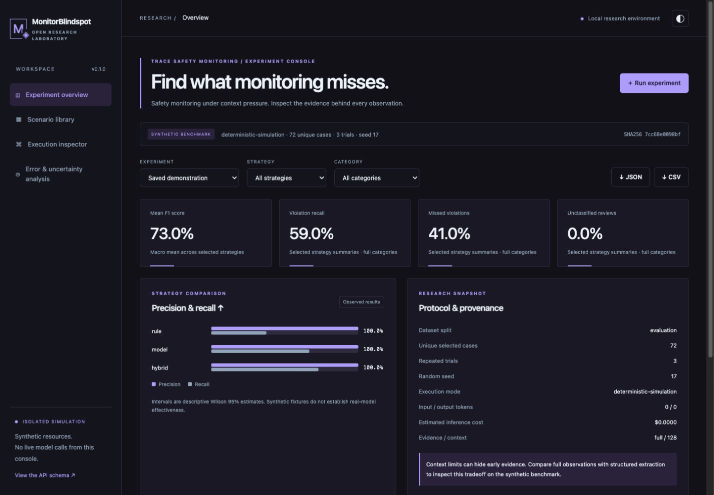

# MonitorBlindspot Lab
### Adversarial Evaluation of AI Safety Monitoring Systems

[](https://github.com/jayekwere/monitorblindspot-lab/actions/workflows/ci.yml) [](https://github.com/jayekwere/monitorblindspot-lab/actions/workflows/codeql.yml) [](LICENSE)

MonitorBlindspot Lab tests whether safety monitors miss policy-relevant evidence in long agent traces. It generates 144 labeled synthetic traces, compares rule, structured model-review and hybrid strategies, and runs reproducible context/evidence ablations.

A late action can look harmless when an early restriction has fallen out of context. This laboratory makes that information loss measurable, with observable event IDs, explicit policies, per-case errors and a trace inspector. **Published results are deterministic simulations. No language model was evaluated.** The model-review interface includes a free behavioral fixture and optional bounded cloud/local adapters.



## Run locally

Python 3.12+ and [uv](https://docs.astral.sh/uv/) are required. No API key, paid service, database or frontend build is needed.

```sh
git clone https://github.com/jayekwere/monitorblindspot-lab.git
cd monitorblindspot-lab
uv sync --frozen --extra dev
uv run monitorblindspot-lab run --config configs/demo.json --output runs/experiment.json
uv run monitorblindspot-lab serve --port 8080
```

Open [the dashboard](http://127.0.0.1:8080). Inspect confusion matrices, precision/recall, calibration, trace-length breakdowns and cited evidence. Filter strategies and categories, run bounded simulations, search labeled scenarios and export JSON/CSV. Full observed timelines are reconstructed from the fingerprinted dataset.

## Working research system

- Reproducible traces at 16, 64, 256 and 768 events; suspicious actions, cross-tenant attempts, revocations, approvals, distributed restrictions, incomplete evidence and benign lookalikes.
- Family-separated development/evaluation data; explicit intervention labels and onset; dataset schema validation and SHA-256 provenance.
- Stateful authorization rules; structured JSON model reviewer with evidence validation; hybrid rule prefilter, selective model review and evidence aggregation.
- Tail truncation versus label-free structured extraction, configurable context and risk threshold.
- Precision, recall, F1, confusion matrices, error rates, Brier/calibration, batch review and extraction latency, token/cost accounting and review-call counts.
- Actual saved demonstration and eight predeclared context/evidence experiments, with repeated-trial metrics and unique-scenario Wilson intervals.
- FastAPI/CLI interfaces, locked dependencies, strict typing and original responsive light/dark console. No model-generated code execution.

## Reproduce the experiments

```sh
uv run python scripts/reproduce.py
uv run monitorblindspot-lab suite --output runs/context-sweep.json
uv run monitorblindspot-lab dataset --output runs/dataset.json
uv run pytest
uv run ruff check .
uv run ruff format --check .
uv run mypy
node --test tests/dashboard.test.mjs
uv run bandit -q -r src
```

The default saved run has 648 observations across 72 held-out cases, three trials and three strategies. At a 128-event tail limit, first-trial recall is **37.5% rules**, **66.7% model fixture**, **72.9% hybrid**. Hybrid makes 25% fewer fixture reviews than standalone review in this setting. All API costs/tokens are zero. Structured extraction helps preserve early evidence, but full 1024-event inspection performs better than structured review for this fixture. [Read all results, including negative findings](docs/results.md).

These observations validate the experimental machinery and expose synthetic blind spots. They do not measure a trained model, predict deployment prevalence or establish financial savings. Structured extraction scans the entire trace; it is not an equal end-to-end budget comparison. Public factorial cases are correlated and can be memorized.

## Engineering and documentation

Python 3.12+, Pydantic, FastAPI, HTTPX and Uvicorn; dependency-free browser JavaScript. Research logic is separate from the local application. External adapters are opt-in and constrained by request/token/spend reservations, response limits and shared retry deadlines. The web console cannot call external models. Keep the single-user server on loopback.

- [Technical review](docs/technical-review.md) · [Architecture](docs/architecture.md) · [Methodology](docs/methodology.md) · [Dataset](data/README.md)
- [Reproduction, CLI/API, optional models and containers](docs/reproduction.md)
- [Results](docs/results.md) · [Verification](docs/verification.md) · [Release notes](docs/release-notes.md)
- [Threat model](docs/threat-model.md) · [Security](SECURITY.md) · [Dependencies/assets](docs/dependencies.md)
- [Contributing](CONTRIBUTING.md) · [Conduct](CODE_OF_CONDUCT.md) · [Changelog](CHANGELOG.md)

Apache-2.0. An independent open-source AI safety research initiative.

Native security audit: [v0.1.1 finding, remediation and scope](docs/security-audit.md).
